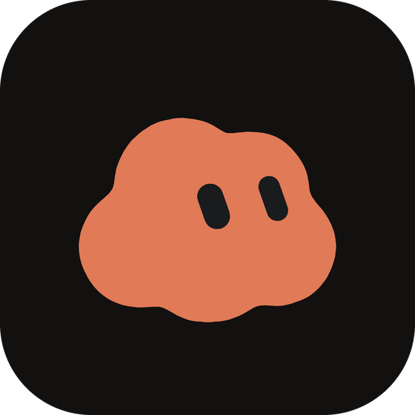
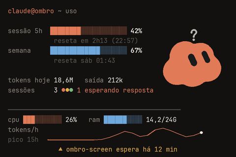

<p align="center">
  
</p>

<h1 align="center">Ombro Screen</h1>
<p align="center">O uso do Claude Code e do seu Mac numa telinha USB, com um cloud que reage ao que o Claude está fazendo.</p>

<p align="center">
  
</p>

---

O uso do Claude Code, o CPU e a RAM do Mac numa telinha USB de 3,5" deitada (480×320), com um mascote, o **cloud**, que reage ao que o Claude está fazendo. A imagem acima usa dados de demonstração (`--demo`).

- **Uso do plano**: sessão de 5 h e semana, com o horário em que cada uma reinicia
- **Hoje**: tokens gastos, tokens de saída, sessões abertas (uma bolinha por sessão) e a curva de tokens por hora
- **Hardware**: CPU e RAM
- **Aviso**: qual projeto espera você e há quanto tempo (ou "nenhuma sessão esperando")
- **Cloud**: ocioso, trabalhando, esperando, alerta ou reset, cada um com a sua animação

Tudo sai de arquivos locais: não usa a API nem lê credenciais.

## 1. Instalar

O Ombro Screen **precisa da biblioteca [turing-smart-screen-python](https://github.com/mathoudebine/turing-smart-screen-python)** (GPL-3.0) para falar com a telinha USB. Ela **não vem neste repositório**: clone-a dentro da pasta do projeto, com o nome `turing-smart-screen-python` (é onde o `tela.py` a procura; use `--lib` para outro caminho):

```bash
git clone https://github.com/jvrodrigs/ombro-screen.git ombro-screen
cd ombro-screen
git clone https://github.com/mathoudebine/turing-smart-screen-python.git
```

Só o simulador (sem `--usb`) funciona mesmo sem ela.

```bash
python3 -m venv .venv && source .venv/bin/activate
pip install -r requirements.txt     # Pillow, psutil, pyserial e numpy (a biblioteca da tela usa o numpy)
brew install macmon                 # opcional: uso de CPU por tipo de núcleo no Apple Silicon (sem sudo)
```

Sem o `macmon` a tela funciona: CPU e RAM vêm do `psutil`. O `macmon` só é necessário para GPU, temperatura e consumo, que aparecem apenas no layout clássico (`--layout classico`).

## 2. Ver no simulador

```bash
python3 tela.py                          # seus dados de verdade
python3 tela.py --demo                   # dados inventados (o cloud fica em "esperando")
python3 tela.py --demo --demo-ciclo 7    # o cloud passa por todos os estados, 7 s cada
```

Abre `http://localhost:5680` no navegador. Para salvar um quadro: `python3 tela.py --png quadro.png`.

O layout do Ombro é o padrão e é sempre 480×320. O painel antigo (anéis, GPU, rede, disco) continua disponível com `--layout classico`; nele, `--paisagem` deita a tela.

## 3. Os estados do cloud

O estado vem do que o Claude Code grava, na ordem de prioridade abaixo:

| Estado | Quando | Dado usado |
| --- | --- | --- |
| **reset** | a janela de 5 h ou da semana reiniciou | o horário de reset avançou mais de 1 h |
| **esperando** | alguma sessão espera sua resposta ou permissão | `status: waiting` em `~/.claude/sessions` |
| **alerta** | o uso do plano passou de 90 % | `% de uso` da sessão de 5 h ou da semana |
| **trabalhando** | alguma sessão está ocupada | `status: busy` em `~/.claude/sessions` |
| **ocioso** | nada acima, há mais de 3 s | |

A cada troca de estado, o cloud ganha uma cor sorteada (matiz livre, saturação e luminosidade limitadas para ler bem sobre o fundo escuro). Para fixar uma cor: `--cor-mascote "#3D7A4F"`.

A forma do cloud e os olhos vêm da KEY de formas dos avatares do Grok Bot; os pontos do contorno estão em `dados_cloud.py`. O mockup aprovado do layout é `ombro-screen-views/exemplo-b.html`.

## 4. De onde vem o uso de 5 h e da semana

A tela usa a fonte mais recente entre as três abaixo:

1. `~/.ombro-screen/uso.json`, gravado pelo `statusline_tap.py` (ao vivo; opcional)
2. `~/.habblaud/usage/<conta>.json`, se o Habblaud estiver instalado (opcional)
3. o que o Claude Code guarda ao rodar `/usage` (só atualiza quando você roda o comando)

Números com mais de 30 min aparecem em âmbar como "números de N min atrás". Uma janela cujo horário de reset já passou é descartada.

### Sem o Habblaud

O Habblaud é opcional: sem ele, a tela cai sozinha para a próxima fonte disponível. Você tem duas saídas:

1. **Não fazer nada.** Rode `/usage` no Claude Code de vez em quando. O Claude Code guarda o resultado em `~/.claude.json` e a tela o usa. Os números só atualizam quando você roda o comando, então depois de 30 min aparecem em âmbar como "números de N min atrás".
2. **Ligar o `statusline_tap.py`** (próxima seção). Os números passam a chegar ao vivo, a cada resposta do Claude Code, sem precisar do Habblaud nem do `/usage`.

Sem nenhuma das fontes, o uso do plano aparece como "—"; o resto da tela (tokens de hoje, CPU, RAM, sessões e o cloud) funciona normalmente.

### Ligar o `statusline_tap.py` (opcional)

O Claude Code envia os percentuais ao comando de **statusline**; o tap grava só esses números. Isso altera o `~/.claude/settings.json`, então faça um backup antes:

```json
{
  "statusLine": {
    "type": "command",
    "command": "python3 /CAMINHO/ombro-screen/statusline_tap.py"
  }
}
```

Já tem um statusline? Coloque o comando dele depois de `--` e ele continua igual (teste antes de confiar):

```json
"command": "python3 /CAMINHO/ombro-screen/statusline_tap.py -- npx -y ccstatusline"
```

Os números chegam depois da próxima resposta do Claude Code.

## 5. Usar a tela de verdade

```bash
ls /dev/cu.*                                  # a tela aparece como usbmodem
python3 tela.py --usb --revisao A
```

- `--revisao`: A (Turing 3.5" e UsbPCMonitor), B (XuanFang), C (Turing 5"), D (Kipye Qiye) ou WEACT_A.
  Para descobrir a sua: <https://github.com/mathoudebine/turing-smart-screen-python/wiki/Hardware-revisions>.
  A tela com serial `USB35INCHIPSV2` é a revisão A.
- `--porta /dev/cu.usbmodemXXXX` se a detecção automática falhar.
- `--girar` se ela aparecer de cabeça para baixo no case.
- `--brilho 30` é o padrão: a revisão A esquenta acima de 50 %.
- `--intervalo 0.2` é o padrão do layout do Ombro (5 quadros por segundo). O cloud anima, então o ritmo é maior que no painel clássico (1 por segundo).

**Velocidade medida** (revisão A): a ligação serial leva cerca de 244 KiB/s. Um quadro inteiro demora 1,25 s e, na animação, só os trechos que mudam são reenviados (cerca de 21 KiB por quadro, ≈ 86 ms). Desenhar leva ≈ 33 ms, então o limite é de uns 8 quadros por segundo. O processo usa cerca de 24 % de um núcleo do Mac.

## 6. Deixar rodando sempre (opcional)

Salve como `~/Library/LaunchAgents/com.ombro-screen.plist`, ajuste os caminhos e rode
`launchctl load ~/Library/LaunchAgents/com.ombro-screen.plist`:

```xml
<?xml version="1.0" encoding="UTF-8"?>
<!DOCTYPE plist PUBLIC "-//Apple//DTD PLIST 1.0//EN" "http://www.apple.com/DTDs/PropertyList-1.0.dtd">
<plist version="1.0"><dict>
  <key>Label</key><string>com.ombro-screen</string>
  <key>ProgramArguments</key><array>
    <string>/CAMINHO/ombro-screen/.venv/bin/python</string>
    <string>/CAMINHO/ombro-screen/tela.py</string>
    <string>--usb</string>
  </array>
  <key>WorkingDirectory</key><string>/CAMINHO/ombro-screen</string>
  <key>EnvironmentVariables</key><dict>
    <key>PATH</key><string>/opt/homebrew/bin:/usr/bin:/bin</string>
  </dict>
  <key>RunAtLoad</key><true/>
  <key>KeepAlive</key><true/>
</dict></plist>
```

## Arquivos

| Arquivo | O que faz |
| --- | --- |
| `tela.py` | Ponto de entrada: laço, opções, simulador ou USB |
| `layout_ombro.py` | O layout do Ombro (480×320): texto, barras, curva de tokens, aviso e o cloud |
| `mascote.py` | O cloud: animação por estado, extras (zZ, "?", pontinhos, suor, confete) e a máquina de estados |
| `dados_cloud.py` | Contorno e olhos do cloud, extraídos da KEY de formas |
| `render.py` | Cores, fontes, formatação pt-BR e o painel clássico |
| `saida.py` | Simulador no navegador e envio para a tela USB |
| `coletores/hardware.py` | psutil + macmon |
| `coletores/claude.py` | Uso do plano, tokens de hoje (e por hora), sessões abertas e quem espera você |
| `coletores/demo.py` | Dados inventados para `--demo` e `--demo-ciclo` |
| `statusline_tap.py` | Captura o uso de 5 h e semanal do statusline (opcional) |

Se algum arquivo do Claude Code estiver estranho, o erro vira um aviso no terminal e a tela segue; campos sem dado aparecem como "—".

Contas extras do Claude Code: `--claude-dir ~/.claude-conta2`.

Fonte: JetBrains Mono (licença OFL, em `fontes/`). A biblioteca da tela (turing-smart-screen-python, GPL-3.0) não é redistribuída aqui.
