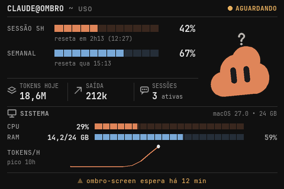
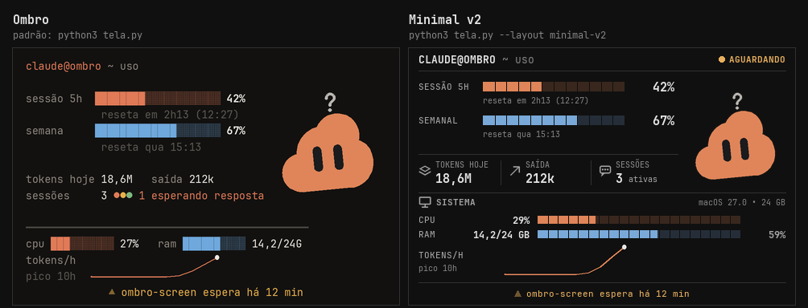
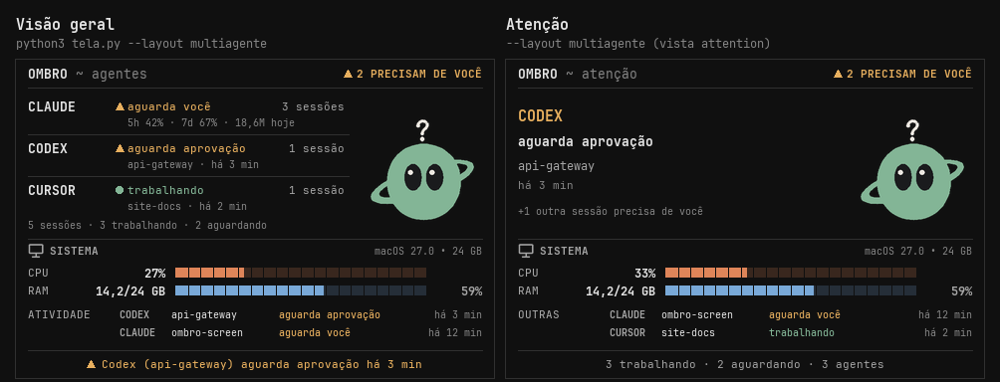

<p align="center">
  
</p>

<h1 align="center">Ombro Screen</h1>
<p align="center">O uso do Claude Code e do seu Mac numa telinha USB, com um cloud que reage ao que o Claude está fazendo.</p>

<p align="center">
  
</p>

---

O uso do Claude Code, o CPU e a RAM do Mac numa telinha USB de 3,5" deitada (480×320), com um mascote, o **cloud**, que reage ao que o Claude está fazendo. A imagem acima é o layout **Minimal v2** (`--layout minimal-v2`) com dados de demonstração (`--demo`); o layout do Ombro continua sendo o padrão (os dois lado a lado na [seção 2](#layout-minimal-v2)).

- **Uso do plano**: sessão de 5 h e semana, com o horário em que cada uma reinicia
- **Hoje**: tokens gastos, tokens de saída, sessões abertas e a curva de tokens por hora
- **Sistema**: CPU e RAM; no Minimal v2, em barras proporcionais à RAM total real do Mac, com cores por nível e a Memory Pressure do macOS
- **Aviso**: qual projeto espera você e há quanto tempo (ou "nenhuma sessão aguardando")
- **Cloud**: ocioso, trabalhando, esperando, alerta, reset ou concluído, cada um com a sua animação
- **Três layouts**: o do Ombro (padrão), o Minimal v2 e o clássico (o painel antigo, com GPU, rede e disco)

Tudo sai de arquivos locais: não usa a API nem lê credenciais.

## Ombro.app (macOS)

O jeito mais simples de usar: um app para Mac que traz tudo o que precisa (não é preciso Python, Homebrew nem
terminal). Ele mostra os agentes e o Mac numa janela e na Menu Bar, configura as integrações com um clique (sempre
mostrando antes o que muda), mostra a prévia da telinha e cuida do serviço em segundo plano.

- **Painel**: agentes (cada um com o seu avatar), sessões, quem espera você, limites de uso com o horário de reset, tokens de hoje, CPU e RAM
- **Agentes**: instalar, conferir, reparar e remover as integrações do Claude Code, Codex e Cursor
- **Tela**: a prévia ao vivo do que a telinha mostra (o mesmo desenho, sem a tela USB), layout, orientação, brilho e hardware. Layout, girar 180°, clássico deitado e brilho mudam na hora, sem reiniciar nada
- **Aparência**: o avatar de cada agente (galeria com doze, ou aleatório), o pacote de animações do mascote (Vivo ou Clássico, nos seis estados, para todos os agentes), a cor e o layout multiagente
- **Diagnóstico** (o `ombro doctor`, com relatório para issues) e **Ajustes**
- **Menu Bar**: o cloud com o resumo; notificações opcionais quando uma sessão espera você

**Compatibilidade:** Mac com Apple Silicon (M1 ou mais novo) e macOS 13 ou mais novo. A telinha USB é opcional;
no app, a revisão A (a Turing de 3,5", 480×320). Claude Code, Codex e Cursor são opcionais.

### Instalar

1. Em [Releases](https://github.com/jvrodrigs/ombro-screen/releases), baixe o `Ombro-v<versão>-macos-arm64.dmg` e
   o `SHA256SUMS.txt`. Confira o download com `shasum -a 256 -c SHA256SUMS.txt` (a resposta deve ser `OK`).
2. Abra o DMG e arraste o **Ombro** para **Aplicativos**. Abra sempre a partir de Aplicativos.
3. **Primeira abertura:** a beta tem assinatura ad-hoc e **não é notarizada pela Apple**, então o macOS avisa que
   não pôde verificar o app. Se você confia na origem, feche o aviso, vá em **Ajustes do Sistema > Privacidade e
   Segurança**, clique em **Abrir Mesmo Assim** ao lado do Ombro e depois em **Abrir**
   ([como a Apple explica](https://support.apple.com/pt-br/102445)). Só é preciso uma vez.

Passo a passo, primeiro uso e como desinstalar: [docs/macos-installation.md](docs/macos-installation.md).

### Limitações da beta

- **Sem notarização:** a primeira abertura precisa da autorização acima. Macs gerenciados por empresa ou escola
  (MDM) podem não permitir.
- **Só Apple Silicon:** não há build para Intel (nunca foi testada).
- **Sem atualização automática:** Ajustes > Atualizações abre a página de releases; a versão nova se instala
  arrastando o app de novo para Aplicativos (configurações e histórico ficam).
- **Limites do Claude (5 h e semana):** os percentuais vêm do Claude Code no terminal (statusline ou `/usage`). Quem
  usa só o app do Claude não tem uma fonte que os atualize sozinha: o Ombro mostra a idade do número em vez de
  inventar um valor ([seção 4](#4-de-onde-vem-o-uso-de-5-h-e-da-semana)).
- **Telinhas B, C, D e WeAct:** ainda só pelo repositório (precisam da biblioteca GPL da tela, que não vai no app).
- **Animações:** dá para escolher o pacote Vivo (padrão) ou o Clássico. Os estilos 3D e Terminal do mascotinhos
  aparecem como "em avaliação" e não podem ser escolhidos ([os motivos](docs/avatars.md#pacote-de-animações)).
- É uma beta: abra uma [issue](https://github.com/jvrodrigs/ombro-screen/issues) com o relatório do Diagnóstico
  (Copiar relatório) se algo der errado.

### Privacidade

Tudo roda no seu Mac: sem conta, sem nuvem, sem telemetria e sem chaves de API. O Ombro lê os arquivos locais dos
agentes só para contar sessões, tokens e eventos, não lê credenciais e não envia nada pela rede. As integrações só mudam os arquivos de um agente depois da sua
confirmação, com backup. Os dados do Ombro ficam em `~/.ombro-screen`.

### Licença

[MIT](LICENSE). Os componentes de terceiros que vão no app e as licenças deles estão em
[docs/licenses.md](docs/licenses.md) e no app, em Ajustes > Sobre > Avisos de terceiros.

### Usar pelo repositório

O app usa o mesmo código deste repositório: tudo abaixo (o `tela.py`, o `ombrod`, a CLI e o simulador) continua
funcionando para desenvolver, para as revisões de tela que o app ainda não traz (B, C, D e WeAct, que precisam da
biblioteca GPL da tela) e para quem prefere o terminal. Desenvolver o app: [docs/development.md](docs/development.md);
montar e publicar: [docs/distribution.md](docs/distribution.md).

## 1. Instalar

O Ombro Screen **precisa da biblioteca [turing-smart-screen-python](https://github.com/mathoudebine/turing-smart-screen-python)** (GPL-3.0) para falar com a telinha USB. Ela **não vem neste repositório**: clone-a dentro da pasta do projeto, com o nome `turing-smart-screen-python` (é onde o `tela.py` a procura; use `--lib` para outro caminho):

```bash
git clone https://github.com/jvrodrigs/ombro-screen.git ombro-screen
cd ombro-screen
git clone --depth 1 --filter=blob:none --sparse https://github.com/mathoudebine/turing-smart-screen-python.git
git -C turing-smart-screen-python sparse-checkout set library
```

O Ombro só usa a pasta `library/` da biblioteca. Baixar só ela leva cerca de 1 MB; o repositório inteiro passa de 1,9 GB por causa dos temas em `res/`. Um `git clone` comum também funciona.

Só o simulador (sem `--usb`) funciona mesmo sem ela.

```bash
python3 -m venv .venv && source .venv/bin/activate
pip install -r requirements.txt     # Pillow, psutil, pyserial, numpy (da biblioteca da tela) e mascotinhos (o mascote)
brew install macmon                 # opcional: uso de CPU por tipo de núcleo no Apple Silicon (sem sudo)
brew install libusb                 # no Mac: necessário para a tela revisão A mostrar a imagem certa (seção 5)
```

Funciona do Python 3.9 (o `python3` que vem com o macOS) ao 3.14. Se o `python3` do seu terminal for o do sistema, prefira o do Homebrew: `/opt/homebrew/bin/python3 -m venv .venv`.

Sem o `macmon` a tela funciona: CPU e RAM vêm do `psutil`. O `macmon` só é necessário para GPU, temperatura e consumo, que aparecem apenas no layout clássico (`--layout classico`).

## 2. Ver no simulador

```bash
python3 tela.py                          # seus dados de verdade
python3 tela.py --demo                   # dados inventados (o cloud fica em "esperando")
python3 tela.py --demo --demo-ciclo 7    # o cloud passa por todos os estados, 7 s cada
```

Abre `http://localhost:5680` no navegador. Para salvar um quadro: `python3 tela.py --png quadro.png`.

O layout do Ombro é o padrão e é sempre 480×320. O painel antigo (anéis, GPU, rede, disco) continua disponível com `--layout classico`; nele, `--paisagem` deita a tela.

### Layout Minimal v2

```bash
python3 tela.py --layout minimal-v2              # no simulador
python3 tela.py --usb --layout minimal-v2        # na tela
```

<p align="center">
  
</p>

O mesmo conteúdo do layout do Ombro, mais limpo: cabeçalho com o estado (o mesmo do cloud), as duas barras de uso alinhadas, tokens hoje, saída e sessões em três colunas com ícones, a seção **Sistema** (com o macOS e a RAM total do seu Mac) com **CPU e RAM em barras proporcionais**, tokens por hora e quem espera você. O layout do Ombro continua sendo o padrão; para deixar o Minimal v2 fixo, use `"layout": "minimal-v2"` no arquivo de configuração (seção 7).

- É desenhado direto em 480×320 (o do Ombro desenha em 960×640 e reduz), então o texto sai nítido no tamanho real. Só o cloud e a linha de tokens por hora são desenhados maiores e reduzidos, para as curvas não serrilharem.
- A RAM é a usada sobre o **total real do seu Mac** (8, 16, 18, 24, 32, 36, 64 GB…), lido do sistema. O nome e a versão do sistema ("macOS 27.0") também vêm do próprio Python, sem programa externo.
- Os ícones (tokens, saída, sessões e sistema) são desenhados em traço fino pelo próprio Ombro: não dependem de a fonte ter emoji.
- Custo: desenhar um quadro leva ≈ 1,8 ms (o do Ombro, ≈ 4,3 ms), porque a parte que não muda é reaproveitada entre quadros. Na tela de verdade, o processo usou ≈ 3,4 % de um núcleo (o layout do Ombro, ≈ 5,1 %, medidos do mesmo jeito).
- Cores das barras (o texto também muda, para não depender só da cor):

| Barra | Normal | Atenção (amarelo) | Crítico (vermelho) |
| --- | --- | --- | --- |
| CPU | laranja, abaixo de 75 % | de 75 % a 89 % | 90 % ou mais |
| RAM | azul, abaixo de 85 % | de 85 % a 93 % | 94 % ou mais |
| Uso de 5 h e da semana | laranja / azul, abaixo de 75 % | de 75 % a 89 % | 90 % ou mais |

- **Memory Pressure:** no macOS, o Ombro também lê a pressão de memória (a mesma do Monitor de Atividade), direto do sistema e sem programa externo. Se ela estiver em atenção ou crítica, a barra de RAM fica amarela ou vermelha mesmo com a ocupação baixa, e o canto direito mostra `pressão` em vez do percentual. A ocupação sozinha nunca é tratada como pressão.
- Para não piscar perto de um limite, a cor sobe na hora, mas só desce quando o valor cai 2 pontos abaixo dele.
- Sem leitura de CPU ou RAM, aparece "—" e a barra vazia (nunca um 0 % inventado).

Limitações: em outros sistemas que não o macOS, a pressão de memória não existe e vale só a ocupação. O texto de 10 px é o menor usado; confira se lê bem na distância em que a sua tela fica.

## 3. Os estados do cloud

O estado vem do que o Claude Code grava, na ordem de prioridade abaixo:

| Estado | Quando | Dado usado |
| --- | --- | --- |
| **reset** | a janela de 5 h ou da semana reiniciou | o horário de reset avançou mais de 1 h |
| **esperando** | alguma sessão espera sua resposta ou permissão | `status: waiting` em `~/.claude/sessions` |
| **alerta** | o uso do plano passou de 90 % | `% de uso` da sessão de 5 h ou da semana |
| **trabalhando** | alguma sessão está ocupada | `status: busy` em `~/.claude/sessions` |
| **concluído** | o Claude terminou o que fazia, há menos de 5 min | as sessões saíram de `busy` sem passar a esperar você |
| **ocioso** | nada acima, há mais de 3 s | |

O **concluído** começa com um pulinho e um ✓ acima da cabeça, com olhos em arco (^ ^), e depois só respira devagar. Ele dura até 5 min; se nesse tempo o Claude voltar a trabalhar (outra mensagem, na mesma sessão ou em outra), o cloud volta para trabalhando, e os 5 min recomeçam quando ele terminar de novo. Passados os 5 min sem nada, o cloud volta a dormir (ocioso, com o zZ). Uma sessão que esperava você e foi cancelada não conta como concluída. No `--demo-ciclo`, o concluído dura um cenário em vez de 5 min.

**Cor:** por padrão, a cor do agente (o Claude laranja, o Codex verde, o Cursor azul). Com `"cor_modo": "sorteada"`, o cloud ganha uma cor sorteada a cada troca de estado (matiz livre, saturação e luminosidade limitadas para ler bem sobre o fundo escuro). Para fixar uma cor: `--cor-mascote "#3D7A4F"`.

**Avatares:** a forma do mascote é um avatar, no formato do [open-bot-avatar](https://github.com/DominikScholz/open-bot-avatar) (MIT). O padrão é o **Ombro Cloud**; cada agente pode ter o seu (Codex: Órbita; Cursor: Cubo), um específico ou um aleatório, e os estados e animações acima valem para todos. A telinha e o Ombro.app desenham e animam os avatares com a mesma biblioteca, o [mascotinhos](https://github.com/GilsonB12/mascotinhos) (MIT). Os doze avatares, como escolher e como criar um: [docs/avatars.md](docs/avatars.md).

<p align="center">
  
</p>

## 4. De onde vem o uso de 5 h e da semana

A tela usa a observação mais recente entre as três fontes abaixo (no empate, a primeira da lista):

1. `~/.ombro-screen/uso.json`, gravado pelo `statusline_tap.py` (a cada resposta do Claude Code no terminal; opcional)
2. o que o Claude Code guarda ao rodar `/usage` (só atualiza quando você roda o comando)
3. `~/.habblaud/usage/<conta>.json`, se o Habblaud estiver instalado (opcional)

**O que esses números são.** São os limites da assinatura inteira: o que você gasta no app Claude e no claude.ai conta neles. Mas quem os observa é só o Claude Code no terminal, quando recebe uma resposta (statusline) ou roda `/usage`. O app Claude Desktop, incluindo a aba Code, não escreve em nenhuma dessas fontes. Usando só o app, os percentuais do Ombro ficam parados no último valor observado até você conversar com o Claude Code num terminal.

**Por que o Ombro não busca sozinho.** Não existe interface suportada para um app de fora consultar o uso da assinatura, e a Anthropic não permite que terceiros usem as credenciais da assinatura ([Legal and compliance](https://code.claude.com/docs/en/legal-and-compliance)). O Ombro não consulta nada pela rede, não lê credenciais e não abre sessões para forçar uma atualização.

**Por isso a idade está sempre à vista.**

- No Ombro.app, cada limite mostra "Atualizado há 2 min" ou, depois de 15 min, "Último valor conhecido · há 38 min". Sem nenhuma fonte: "Dados indisponíveis".
- Na telinha, depois de 15 min aparece em âmbar "números de N min atrás".
- Uma janela cujo horário de reset já passou fica sem número ("Aguardando atualização" no app, "—" na telinha) até a próxima observação. O Ombro nunca presume 0%.
- Depois de trocar de conta no Claude Code, o que foi observado antes é descartado.
- `python3 -m ombro quotas` mostra a fonte, quando foi observado, o que cobre e como se atualiza. O `ombro doctor` confere sessões, tokens locais e limites em separado: ter sessões e tokens em dia não diz nada sobre os limites.

### Sem o Habblaud

O Habblaud é opcional: sem ele, a tela cai sozinha para a próxima fonte disponível. Você tem duas saídas:

1. **Não fazer nada.** Rode `/usage` no Claude Code de vez em quando. O Claude Code guarda o resultado em `~/.claude.json` e a tela o usa. Os números só atualizam quando você roda o comando, então depois de 15 min aparecem em âmbar como "números de N min atrás".
2. **Ligar o `statusline_tap.py`** (próxima seção). Os números passam a chegar a cada resposta do Claude Code no terminal, sem precisar do Habblaud nem do `/usage`.

Sem nenhuma das fontes, o uso do plano aparece como "—"; o resto da tela (tokens de hoje, CPU, RAM, sessões e o cloud) funciona normalmente.

### Ligar o `statusline_tap.py` (opcional)

O Claude Code envia os percentuais ao comando de **statusline**; o tap grava só esses números. Isso altera o `~/.claude/settings.json`, então faça um backup antes:

```json
{
  "statusLine": {
    "type": "command",
    "command": "python3 /CAMINHO/ombro-screen/statusline_tap.py"
  }
}
```

Já tem um statusline? Coloque o comando dele depois de `--` e ele continua igual (teste antes de confiar):

```json
"command": "python3 /CAMINHO/ombro-screen/statusline_tap.py -- npx -y ccstatusline"
```

Os números chegam depois da próxima resposta do Claude Code.

## 5. Usar a tela de verdade

```bash
ls /dev/cu.*                                  # a tela aparece como usbmodem
python3 tela.py --usb --revisao A
```

**No Mac, a revisão A vai direto pelo USB.** Pela porta serial, o macOS reagrupa os bytes e o firmware desta tela se perde: a imagem vira faixas e ruído azul que piscam. É um problema conhecido da biblioteca ([#7](https://github.com/mathoudebine/turing-smart-screen-python/issues/7), [#512](https://github.com/mathoudebine/turing-smart-screen-python/issues/512)) que ajustes na serial não resolvem. Por isso, no Mac com a revisão A, o Ombro escreve direto no endpoint USB da tela (`usb_direto.py`), sem a porta serial e sem a biblioteca da tela. Precisa do `pyusb` (já está no `requirements.txt`) e do `brew install libusb`.

- `--transporte auto` (padrão): USB direto no Mac com a revisão A; porta serial nos outros casos.
- `--transporte usb` força o USB direto; `--transporte serial` força a porta serial da biblioteca.
- **A tela ficou embaralhada?** Depois que ela se perde, nem o comando de reset chega: tire o cabo, espere uns segundos e plugue de novo. Acontece, por exemplo, se outro programa (ou o Ombro com `--transporte serial`) mandou imagem pela serial.

- `--revisao`: A (Turing 3.5" e UsbPCMonitor), B (XuanFang), C (Turing 5"), D (Kipye Qiye) ou WEACT_A.
  Para descobrir a sua: <https://github.com/mathoudebine/turing-smart-screen-python/wiki/Hardware-revisions>.
  A tela com serial `USB35INCHIPSV2` é a revisão A.
- `--porta /dev/cu.usbmodemXXXX` se a detecção automática falhar (na revisão A ela costuma ser `/dev/cu.usbmodemUSB35INCHIPSV21`).
- `--girar` se ela aparecer de cabeça para baixo no case: gira a tela física 180°. Os dados e o desenho são os mesmos (a prévia do app e o simulador mostram o quadro de pé).
- `--paisagem` é só do layout clássico: deitado (480×320) em vez de em pé (320×480). Os outros layouts são sempre deitados e ignoram a opção.
- `--brilho 30` é o padrão: a revisão A esquenta acima de 50 %.
- `--intervalo 0.2` é o padrão do layout do Ombro (5 quadros por segundo). O cloud anima, então o ritmo é maior que no painel clássico (1 por segundo).
- Feche outros programas que usem a tela (o app do fabricante, por exemplo): só um processo consegue abrir a porta serial.

**Cabo solto ou tela desligada:** o programa não fecha. Ele avisa no terminal, tenta de novo a cada 3 s e, quando a tela volta, reconfigura brilho e orientação e manda o quadro inteiro. Também dá para iniciar com a tela desconectada: ela começa a mostrar assim que for plugada.

**Velocidade medida** (revisão A): a ligação serial leva cerca de 244 KiB/s. Um quadro inteiro demora 1,25 s e, na animação, só os trechos que mudam são reenviados (cerca de 21 KiB por quadro, ≈ 86 ms). Desenhar leva ≈ 33 ms, então o limite é de uns 8 quadros por segundo. O processo usa cerca de 24 % de um núcleo do Mac.

No USB direto (Mac Apple Silicon, tela ligada por hub) o envio medido foi de ≈ 150 KiB/s: um quadro inteiro leva ≈ 2 s. Com a animação do cloud, o processo usa cerca de 3 % de um núcleo (medido em 120 s; antes de a parte parada da tela ser reaproveitada entre quadros, eram 5 %). Com a tela desconectada, o Ombro para de desenhar até a próxima tentativa de reconexão e fica abaixo de 1 %.

## 6. Deixar rodando sempre (opcional)

O `ombrod` é o Ombro como serviço: o mesmo laço do `tela.py` (coleta, cloud, layout, tela USB), sem terminal
aberto, com a CLI `python3 -m ombro` para consultar e ajustar (seção 10). Um LaunchAgent o inicia quando você
entra no Mac e o reinicia se ele cair:

```bash
python3 -m ombro service install --usb --dry-run   # mostra o plist e os passos, sem mudar nada
python3 -m ombro service install --usb             # grava ~/Library/LaunchAgents/com.ombro-screen.daemon.plist e liga
python3 -m ombro service status                    # carregado? PID? última saída?
python3 -m ombro service restart                   # depois de mudar o código
python3 -m ombro service stop                      # desliga (volta no próximo login, ou com start)
python3 -m ombro service uninstall                 # desliga e apaga só o plist do Ombro
tail -f ~/Library/Logs/ombro-screen/ombrod.log     # avisos
```

- É do seu usuário (`gui/<uid>`): sem `sudo`, sem LaunchDaemon, nunca como root.
- O plist leva caminhos absolutos (pastas com espaço funcionam) e roda o código e o python desta pasta
  (o que rodou o `install`; outro com `--python`). Se o Homebrew trocar a versão do Python, recrie o `.venv` e
  rode o `install` de novo.
- `--usb` vai para a linha de comando do ombrod; sem ele, vale o `usb` do `config.json`. As outras opções
  ficam melhor no `config.json` (seção 7).
- Só um Ombro ao vivo por vez: com o serviço ligado, `python3 tela.py --usb` recusa e diz quem está rodando;
  `--demo` e `--png` continuam funcionando ao lado.

### Migrar do LaunchAgent antigo

Antes da Fase 4, o README ensinava um LaunchAgent `com.ombro-screen` que roda `tela.py --usb`. Os dois juntos
disputariam a tela, então o `install` recusa enquanto o antigo existe, e o `ombrod` espera ele sair. Para trocar:

```bash
python3 -m ombro service migrate --dry-run   # mostra o que vai fazer
python3 -m ombro service migrate             # guarda o plist antigo, desliga-o e liga o novo
python3 -m ombro service rollback            # se quiser voltar: desliga o novo e devolve o antigo
```

O `migrate` leva as opções do antigo que o ombrod entende (`--usb`, `--brilho 40`...), guarda o plist antigo em
`~/.ombro-screen/backups/launchagents/` e o tira de `~/Library/LaunchAgents` (para não voltar no próximo login).
Se o novo não ligar, ele devolve o antigo sozinho. Nada muda sem você rodar o comando.

## 7. Arquivo de configuração (opcional)

Tudo funciona sem ele. Se quiser deixar opções fixas sem repetir na linha de comando, crie `~/.ombro-screen/config.json` (o Ombro não cria esse arquivo sozinho):

```json
{
  "versao": 1,
  "usb": true,
  "brilho": 40,
  "cor_mascote": "#3D7A4F"
}
```

- As chaves têm o nome das opções da linha de comando, com `_` no lugar de `-`: `usb`, `revisao`, `porta`, `transporte`, `brilho`, `lib`, `paisagem`, `girar`, `sem_macmon`, `claude_dir`, `layout`, `intervalo`, `cor_mascote`, `cor_modo`, `porta_sim`, `nao_abrir` e `debug`; `pacote_animacao` (`vivo`, o padrão, ou `classico`) escolhe as animações do mascote ([docs/avatars.md](docs/avatars.md#pacote-de-animações)). Os avatares ficam num bloco: `"avatars": {"codex": "aleatorio", "random": "sessao"}` ([docs/avatars.md](docs/avatars.md)). `--demo`, `--demo-ciclo` e `--png` só valem na linha de comando.
- **Precedência:** opção dada na linha de comando > arquivo > padrão. Uma opção que você não deu na linha de comando não apaga a do arquivo.
- As opções de ligar e desligar têm a forma negativa, para a linha de comando desfazer o arquivo: `--no-usb`, `--no-paisagem`, `--no-girar`, `--no-sem-macmon`, `--no-nao-abrir`, `--no-debug`.
- Outro arquivo: `--config /caminho/arquivo.json`. A pasta segue a variável `OMBRO_SCREEN_DIR`, a mesma do `uso.json` do `statusline_tap.py`.
- Caminhos relativos no arquivo (como `lib`) são relativos à pasta do arquivo; `~` funciona.
- Valores inválidos impedem o Ombro de iniciar e a mensagem diz qual opção e por quê, por exemplo `cor_mascote deve ser uma cor como "#3D7A4F"` ou `brilho deve ser de 0 a 100`. Chaves desconhecidas viram um aviso e são ignoradas; `versao` existe para o formato poder mudar no futuro.
- Não coloque credenciais: o Ombro não usa nenhuma.

## 8. Diagnóstico de problemas

Os avisos saem no terminal (ou, no LaunchAgent, em `~/Library/Logs/ombro-screen.log`), um por linha:

```
2026-11-14 12:30:00 INFO [ombro.usb] tela USB conectada (USB direto)
2026-11-14 12:31:10 WARNING [ombro.usb] a tela USB parou de responder ([Errno 19] No such device); tentando reconectar a cada 3 s
2026-11-14 12:31:16 INFO [ombro.usb] tela USB reconectada (USB direto)
```

- `python3 tela.py --usb --debug` mostra também os detalhes (nível DEBUG): a configuração resolvida, o traceback de cada falha e, a cada minuto, um resumo do laço (quadros por segundo, tempo de desenho e quantos KiB foram para a tela).
- Cada parte tem o seu nome: `ombro.main`, `ombro.config`, `ombro.claude`, `ombro.hardware`, `ombro.render`, `ombro.usb`, `ombro.simulador`, no núcleo, `ombro.providers`, `ombro.estado`, `ombro.eventos` e `ombro.persistencia`, e, no Hub, `ombro.daemon`, `ombro.ipc`, `ombro.integrations` e `ombro.service`.
- `python3 -m ombro doctor` confere a instalação inteira sem mudar nada (seção 10 e [docs/troubleshooting.md](docs/troubleshooting.md)).
- Um problema que se repete (porta ocupada, arquivo estranho, macmon fora) entra no log uma vez, e a volta ao normal entra uma vez; nada é registrado a cada quadro.
- O log não guarda conteúdo de prompts, respostas ou arquivos do Claude Code, nomes de projeto nem credenciais; a sua pasta pessoal aparece como `~`.

| O que aparece | O que fazer |
| --- | --- |
| `tela USB não encontrada` | Confira o cabo e o hub (`ls /dev/cu.*`); o Ombro tenta de novo sozinho a cada 3 s. |
| `não consegui iniciar a tela USB (... busy ...)` | Outro programa está com a tela: o app do fabricante ou um Ombro antigo (o LaunchAgent de antes da Fase 4: seção 6). |
| `já existe um Ombro rodando (...)` | Só um Ombro ao vivo por vez: pare o outro (`python3 -m ombro service stop`) ou use `--demo`/`--png`. |
| `usando a porta serial, que no macOS costuma embaralhar a imagem` | Falta o `pyusb` ou o `libusb` (seção 5). |
| `sem dados do uso do plano` | Nenhuma fonte de uso de 5 h e da semana ainda (seção 4). |
| `o uso do plano (…) tem mais de 15 min` | Ninguém observou os limites nesse tempo. Envie uma mensagem ou rode `/usage` no Claude Code no terminal; o uso pelo app Claude não atualiza (seção 4). |
| `macmon falhou` ou `macmon parou` | O Ombro segue com o psutil; reinstale com `brew install macmon` se quiser GPU e temperatura. |
| `falha ao desenhar o quadro ... o Ombro vai fechar` | É um bug: abra uma issue com o trecho do log (rode com `--debug` para ter o traceback). |

## 9. Vários agentes: Claude Code, Codex e Cursor

<p align="center">
  
</p>

O Ombro acompanha os três ao mesmo tempo, cada um isolado: funciona com um, dois ou os três instalados.

```bash
python3 tela.py --layout multiagente               # visão geral (no simulador; acrescente --usb para a tela)
python3 tela.py --layout multiagente --demo        # com dados inventados, para ver como fica
```

O Claude Code funciona sem configurar nada. Codex e Cursor precisam dos **hooks do Ombro**, que só são
instalados quando você pede (o Ombro nunca mexe nas suas configurações sozinho):

```bash
python3 -m ombro integrations list                      # o estado dos três
python3 -m ombro integrations install codex --dry-run   # o que mudaria no ~/.codex/hooks.json
python3 -m ombro integrations install codex             # com backup; desfaz com: integrations rollback codex
```

A instalação muda só as entradas do Ombro (o resto do arquivo fica), não duplica nada ao repetir e guarda um
backup antes; detalhes em [docs/integrations.md](docs/integrations.md). Para ligar à mão, ou entender cada
evento: [Claude Code](docs/providers/claude.md), [Codex](docs/providers/codex.md) e [Cursor](docs/providers/cursor.md). Visões, rotação, prioridades e o
transporte dos eventos: [docs/multi-agent.md](docs/multi-agent.md).

| O que o Ombro mostra | Claude Code | Codex | Cursor |
| --- | --- | --- | --- |
| Sessões abertas | sim (arquivos locais) | com os hooks | com os hooks |
| Trabalhando / ocioso | sim | com os hooks | com os hooks |
| Esperando sua resposta | sim | não (o fim do turno aparece como ocioso) | não |
| Esperando aprovação | com os hooks | com os hooks | não (o Cursor não avisa) |
| Parou com erro | com os hooks | com os hooks (falha no pedido ao modelo) | com os hooks |
| Tokens de hoje | sim | não | não |
| Limites de uso e reset | sim (statusline ou `/usage`) | não | não |
| Validado com a ferramenta real | sim (arquivos; hooks de início e fim de sessão) | não: o Codex não estava instalado | em parte: CLI, início e fim de sessão |

- **Privacidade:** o hook guarda só o provider, a sessão, o evento, o horário, o nome da pasta do projeto e
  um status. Nunca prompts, respostas, comandos, conteúdo de arquivos, caminhos completos ou credenciais;
  não usa rede e sempre sai sem bloquear o agente.
- **Dados que não existem ficam em branco**, nunca inventados: o Codex e o Cursor não informam tokens nem
  limites aos hooks. O App Server do Codex não serve a um monitor passivo (ver [docs/providers/codex.md](docs/providers/codex.md)).
- **Conferir os hooks:** rode o Ombro com `--debug` e procure `eventos dos hooks do … chegando`.

## 10. Ombro Hub: o ombrod e a CLI

```bash
python3 ombrod.py                 # o serviço num terminal (as mesmas opções do tela.py, menos --png); ou a seção 6
python3 -m ombro status           # de outro terminal (ou python3 /caminho/ombro-screen/ombro status, de qualquer pasta)
```

```
Ombro Hub

Daemon:        running
Saúde:         healthy
Tempo rodando: 2h 14m 3s
Display:       connected (usb)
Layout:        minimal-v2
Providers:     3 configurados, 2 instalados, 2 operacionais
Sessões:       3
Aguardando:    1
Armazenamento: persistent
IPC:           v1 (ombrod 0.9.0-beta.2, PID 4321)
```

| Comando | O que mostra ou faz |
| --- | --- |
| `status` | estado do ombrod, tela, providers, sessões, armazenamento e a versão da IPC |
| `providers` | cada agente: ligado, instalado, integração, se há dados, estado e a última atualização |
| `sessions [--provider codex] [--full]` | as sessões conhecidas (projeto = nome da pasta, nunca o caminho) |
| `display` | tela: tipo, conexão, revisão, transporte, brilho, orientação, layout, último quadro e erro |
| `display brightness 40 [--persist]` | brilho na hora (`--persist` grava no config.json) |
| `display layout multiagente [--persist]` | troca o layout na hora, qualquer um (o `classico` também) |
| `display preview quadro.png` | o último quadro da tela, sem desenhar de novo |
| `config` / `config set brilho 40` | a configuração em uso, e mudar qualquer preferência (`config set providers.codex false`) |
| `config schema` | todas as preferências que dá para mudar, com os valores aceitos e se valem na hora ou ao reiniciar |
| `config set girar true` / `config set paisagem true` | gira a tela 180°, ou deita o layout clássico, na hora e sem reabrir o USB |
| `health` | a saúde de cada componente |
| `integrations ...` | os hooks dos agentes (seção 9) |
| `service ...` | o LaunchAgent (seção 6) |
| `doctor [--json] [--report]` | diagnóstico completo, sem mudar nada |

Todos aceitam `--json` (saída estável). Sem o ombrod, a CLI diz `O ombrod não está rodando.` e sai com 3, sem
iniciar nada. A CLI só fala com o ombrod pelo socket local `~/.ombro-screen/run/ombro.sock` (protocolo
versionado, sem rede e só para o seu usuário: [docs/ipc.md](docs/ipc.md)); ela não abre o banco, a tela nem os
agentes por conta própria. É a mesma interface que o futuro Ombro.app vai usar.

O `tela.py` continua igual para desenvolver e testar (`--demo`, `--png`, o simulador): não precisa do ombrod nem
da IPC.

## Arquitetura

Os dados dos agentes passam por um núcleo que não depende da tela (`core/`): um **provider** por
ferramenta monitorada (Claude Code, Codex e Cursor, em `providers/`), um modelo comum de sessões,
uso e limites, um estado consolidado (`StateStore`), um barramento de eventos (`EventBus`) e um banco
SQLite pequeno (`~/.ombro-screen/state.db`) para lembrar das sessões ao reiniciar. Os layouts recebem
os dados por `apresentacao.py` (só o Claude) ou por `core/resumo.py` (todos os agentes).

O banco guarda só o status das sessões e as mudanças recentes (sem nome de projeto, conversas ou
tokens), apaga o que tem mais de 7 dias e nunca impede o Ombro de rodar: se der problema com ele, o
Ombro segue em memória e avisa no log. `--demo` e `--png` não usam o banco.

Detalhes, regras e como adicionar um provider: [docs/architecture.md](docs/architecture.md). Os
agentes, os hooks e o layout multiagente estão na seção 9; o ombrod, a IPC e a CLI, na seção 10.

## Arquivos

| Arquivo | O que faz |
| --- | --- |
| `tela.py` | Ponto de entrada de sempre: opções, simulador, USB ou `--png` (o laço está em `ombro/app.py`) |
| `ombrod.py` | O Ombro como serviço local (`ombro/daemon.py`), com a IPC para a CLI |
| `ombro/` | Ombro Hub: o laço (`app.py`), o daemon, a IPC, a CLI (`python3 -m ombro`), integrações, LaunchAgent e doctor |
| `core/` | Núcleo sem tela: modelos, providers, estado, eventos, banco (ver `docs/architecture.md`) |
| `providers/claude.py` | O provider do Claude Code, sobre o coletor de sempre |
| `apresentacao.py` | Do estado do núcleo para o formato que o layout e o cloud usam |
| `providers/codex.py`, `providers/cursor.py` | Codex e Cursor, pelos hooks (`providers/hooks.py` é a base comum) |
| `ombro_hook.py` | O hook que Claude Code, Codex e Cursor chamam; grava só o mínimo em `~/.ombro-screen/eventos/` |
| `layout_multiagente.py` | O layout multiagente (`--layout multiagente`): visão geral, foco e atenção |
| `config.py` | Padrões, arquivo de configuração e validação das opções, resolvidos num lugar só |
| `logging_config.py` | Formato dos logs, `--debug` e o filtro que evita repetir o mesmo aviso |
| `layout_ombro.py` | O layout do Ombro (480×320): texto, barras, curva de tokens, aviso e o cloud |
| `layout_minimal_v2.py` | O layout Minimal v2 (`--layout minimal-v2`), com CPU e RAM em barras e a política de cores |
| `mascote.py` | O mascote: qual estado mostrar e qual avatar e cor usar; o movimento, o desenho e as trocas vêm do mascotinhos (o pacote de animações escolhido, `vivo` por padrão, nos seis estados) |
| `ombro/animacoes.py` | O pacote de animações: o escolhido, o em uso (`animacao.json`) e quando é seguro trocar (sem atividade em nenhum agente) |
| `avatares.py`, `avatars/` | Os avatares (formato do open-bot-avatar): o catálogo, a geometria para a telinha e a escolha por agente |
| `render.py` | Cores, fontes, formatação pt-BR e o painel clássico |
| `saida.py` | Simulador no navegador e envio para a tela USB (com reconexão) |
| `usb_direto.py` | Driver da revisão A direto no endpoint USB, para o Mac |
| `coletores/hardware.py` | psutil + macmon |
| `coletores/claude.py` | Uso do plano, tokens de hoje (e por hora), sessões abertas e quem espera você |
| `coletores/demo.py` | Dados inventados para `--demo` e `--demo-ciclo` |
| `statusline_tap.py` | Captura o uso de 5 h e semanal do statusline (opcional) |
| `app/` | O Ombro.app: a interface (`app/src`, React + TypeScript), o lado nativo (`app/src-tauri`, Tauri 2 + Rust) e o empacotamento (`app/scripts/build_backend.py`) |
| `tests/` | Testes (`unittest`, sem dependências extras) |
| `scripts/` | `benchmark.py` (quanto custa cada parte), `benchmark_hub.py` (ombrod, IPC e CLI), `quadros_referencia.py` (confere que nenhum pixel mudou) e `imagens_readme.py` (refaz as imagens do README) |
| `.github/workflows/tests.yml` | CI: os testes do Python 3.9 ao 3.14 e o lint, a cada push e pull request |
| `.github/workflows/app.yml`, `release.yml` | CI do app (interface e Rust) e a montagem do DMG para as releases ([docs/distribution.md](docs/distribution.md)) |

Se algum arquivo do Claude Code estiver estranho, o erro vira um aviso no terminal e a tela segue; campos sem dado aparecem como "—".

Contas extras do Claude Code: `--claude-dir ~/.claude-conta2`.

Fonte: JetBrains Mono (licença OFL, em `fontes/`). A biblioteca da tela (turing-smart-screen-python, GPL-3.0) não é redistribuída aqui. O Ombro é MIT ([LICENSE](LICENSE)); o que o Ombro.app redistribui está em [docs/licenses.md](docs/licenses.md).

## Testes

```bash
python3 -m unittest discover -s tests -t .
```

Não precisam da tela, da biblioteca da tela, do macmon nem do Claude Code: a `TelaUSB` e o envio direto pelo USB são testados com dispositivos falsos, o hardware com um psutil falso, e o coletor do Claude com pastas temporárias. Nada lê os seus arquivos de verdade. O ombrod, a IPC e a CLI rodam de verdade (subprocessos com `--demo` numa pasta temporária); as integrações usam um HOME temporário e o LaunchAgent, um `launchctl` falso: nenhum teste instala hooks ou serviços.

**CI:** o GitHub Actions (`.github/workflows/tests.yml`) roda os testes no Python 3.9, 3.10, 3.11, 3.12, 3.13 e 3.14 (Ubuntu, sem hardware) e o lint (`ruff check --select F,E9 .`) a cada push e pull request.

**Nenhum pixel mudou?** Os testes não comparam imagens pixel a pixel, porque outra versão do Pillow ou do FreeType desenha as letras um pouco diferente. Para conferir uma mudança na sua máquina:

```bash
python3 scripts/quadros_referencia.py --salvar /tmp/antes.json     # antes de mexer no código
python3 scripts/quadros_referencia.py --comparar /tmp/antes.json   # depois: "60 quadros idênticos"
```

**Quanto custa cada parte:** `python3 scripts/benchmark.py` mede desenho, coleta, preparação do envio e o laço completo, com entradas fixas e uma tela falsa (o USB em si não entra). Compare execuções feitas na mesma máquina.

**O Hub:** `python3 scripts/benchmark_hub.py` mede o início do ombrod, a latência da IPC (uma conexão, conexões novas, 8 clientes), a CLI de ponta a ponta e a CPU e a memória do ombrod ao lado do `tela.py` com o mesmo laço.
