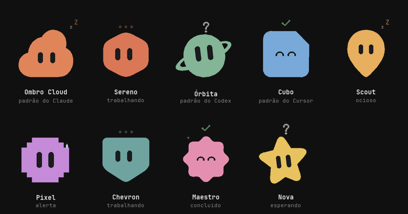

# Avatares

O mascote do Ombro é um avatar: o **Ombro Cloud** por padrão, e um por agente se você quiser. A telinha, a
prévia e o Ombro.app desenham os mesmos avatares, a partir dos mesmos arquivos.

<p align="center">
  
</p>

## De onde vem o formato

Os avatares seguem o formato do [open-bot-avatar](https://github.com/DominikScholz/open-bot-avatar) (MIT,
© Dominik Scholz), o contrato v1: **um path SVG numa caixa 0..100 e onde ficam os dois olhos**. Só geometria. A
cor, os olhos (pílulas que piscam e olham em volta), o volume e o movimento são do renderer.

- **No Ombro.app** o desenho é o próprio motor do open-bot-avatar (pacote npm `open-bot-avatar`, versão fixada): a
  galeria, os cartões dos agentes e a lista de sessões. Ele também valida cada definição. Os cartões dos agentes
  animam pelo estado real de cada um (trabalhando, esperando você, perto do limite, concluído, limite reiniciado,
  ocioso), com os extras da telinha ("?", gota, ✓, pontinhos, confete, z) em CSS. O motor desenha num laço só para
  a página, para quando o avatar sai da tela e respeita o "reduzir movimento" do macOS; a lista de sessões fica
  parada, na pose do estado de cada sessão.
- **Na telinha** o desenho é um adaptador mínimo em Python (`avatares.py`): lê o mesmo JSON, transforma o path em
  polígonos (os comandos `M L H V C S Q T A Z`, a regra nonzero do SVG) e põe os olhos como o contrato descreve
  (4x11 unidades vezes a escala, aumentados até 1,45x onde cabem, como no motor). O movimento, os estados e os
  extras (zZ, "?", pontinhos, gota, confete) continuam os do `mascote.py`: só a forma vem do avatar. Quando o corpo
  inclina (esperando, concluído), os olhos andam de lado como andavam no cloud antigo, cujos olhos ficavam mais
  altos: num avatar de olhos mais baixos, a diferença vira um deslize a mais (`ALTURA_OLHAR`).
- A telinha desenha o avatar plano (sem o volume do motor), como sempre desenhou o cloud: em 480x320, a cada
  0,2 s, um contorno chapado lê melhor e custa menos. A prévia do app mostra exatamente o que a telinha mostra.

Nada foi copiado do projeto base além do formato e do motor (que vem como dependência, com a licença dele nos
avisos de terceiros do app). Os nove avatares foram desenhados para o Ombro.

## A coleção

| Avatar | Padrão de | Ideia |
| --- | --- | --- |
| **Ombro Cloud** | Claude Code, e o Ombro sem agente em foco | O personagem do Ombro: uma nuvem que senta numa base macia, com a cúpula puxada para um lado |
| **Sereno** | | Hexágono de cantos macios: calmo, técnico |
| **Órbita** | Codex | Planeta com um anel inclinado: objetivo, analítico |
| **Cubo** | Cursor | Bloco com um canto dobrado, como uma página: quem constrói |
| **Scout** | | Gota de mapa: explorar, pesquisar |
| **Pixel** | | Cantos em degrau: interface e design |
| **Chevron** | | Escudo com a ponta em chevron: backend e sistemas |
| **Maestro** | | Engrenagem macia de oito lobos: coordenar |
| **Nova** | | Estrela cheinha: neutra, futurista |

Os nove passam no validador estrito do open-bot-avatar (rosto com espaço para os olhos grandes e para o olhar ir
até o fim; contorno sem emendas pequenas).

O **Ombro Cloud** substitui o contorno antigo do cloud, que tinha sido medido num desenho de terceiros. O novo foi
desenhado do zero (outro contorno, outros olhos, as pílulas do contrato do open-bot-avatar), mantendo só o papel
dele no produto: um companheiro simpático que lê bem pequeno e no fundo escuro.

## Escolher

No app: **Aparência > Avatares**. No `config.json`:

```json
{
  "avatars": { "claude": "sereno", "codex": "aleatorio", "default": "ombro-cloud", "random": "sessao" },
  "cor_modo": "agente"
}
```

| Chave | Valores | O que é |
| --- | --- | --- |
| `claude`, `codex`, `cursor` | `"padrao"` (o padrão), `"aleatorio"` ou o id de um avatar | o avatar de cada agente |
| `default` | os mesmos | o do Ombro, quando nenhum agente está em foco no multiagente |
| `random` | `"inicio"` (padrão) ou `"sessao"` | como o `"aleatorio"` escolhe |

- **Padrão:** o do catálogo (`avatars/catalog.json`): Claude → Ombro Cloud, Codex → Órbita, Cursor → Cubo.
- **Aleatório ao iniciar:** um avatar sorteado quando o Ombro inicia, o mesmo até reiniciar.
- **Aleatório por sessão:** cada sessão ganha o seu, sempre o mesmo para ela (o hash FNV-1a de `agente:sessão`).
  A telinha e o app fazem a mesma conta.
- Só entram no sorteio os avatares com `"random": true` no catálogo.
- **Um avatar que não existe** (apagado do catálogo, ou digitado errado no arquivo) vale o padrão do agente,
  com um aviso no log: nunca impede o Ombro de abrir.

## De quem é o mascote agora

- Layouts do Ombro e Minimal v2: o Claude Code (e, no aleatório por sessão, a sessão que espera você, senão a
  que trabalha, senão a mais recente).
- Multiagente: o agente mais urgente (erro, aprovação, esperando você); senão o da visão em foco; senão o único
  que trabalha, ou o único com sessões; senão o Ombro (`default`).
- Alerta e reset vêm dos limites do Claude: nesses estados o mascote é o do Claude, mesmo no multiagente.
- Quando muda de quem é o mascote, a troca leva 0,6 s: o corpo encolhe e fecha os olhos, a forma (e a cor) muda no
  meio e ele volta. O movimento do estado continua sem pular. Uma mudança feita nos ajustes vale na hora.

`display.status.mascot` (IPC) diz qual avatar, de qual agente e em qual estado.

## Cores

`cor_modo`: `"agente"` (padrão) usa a cor de cada agente (Claude laranja, Codex verde, Cursor azul; o Ombro, a do
avatar), e a cor clareia por meio segundo a cada troca de estado, para a troca continuar visível; `"sorteada"` sorteia
uma cor a cada troca de estado (o comportamento de antes). `cor_mascote` (uma cor
fixa, `#RRGGBB`) vale por cima dos dois.

## Adicionar um avatar

1. Desenhe no [editor do open-bot-avatar](https://dominikscholz.github.io/open-bot-avatar/) ou à mão: um path na
   caixa 0..100 (de preferência dentro de 8..92) e os olhos `{x, y, spacing, scale}`.
2. Salve em `avatars/defs/<id>.json`, só com os campos do contrato (`version`, `id`, `name`, `body`, `eyes`).
3. Confira no validador estrito do open-bot-avatar (do repositório dele):
   `node packages/core/scripts/avatar-validate.ts --strict avatars/defs/<id>.json --svg /tmp/<id>.svg`.
4. Acrescente em `avatars/catalog.json`: `id`, `description`, `tags`, `color` (`#RRGGBB`) e `random`.
5. Rode os testes (`python3 -m unittest tests.test_avatares` e, em `app/`, `npm test`) e veja como fica:
   `.venv/bin/python scripts/imagens_readme.py` refaz o `docs/avatares.png`.

Para mudar o padrão de um agente, troque o `avatar` (e a `color`) dele em `providers` no `catalog.json`.

## Licença

O formato e o motor são do open-bot-avatar (MIT); a licença dele vai nos avisos de terceiros do Ombro.app. Os
avatares em `avatars/` são do Ombro, desenhados para ele, e seguem a licença do projeto.
